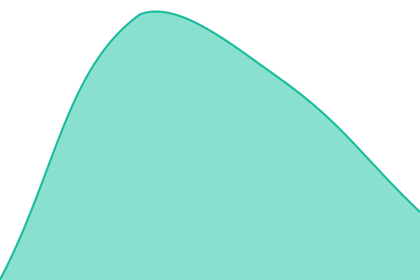
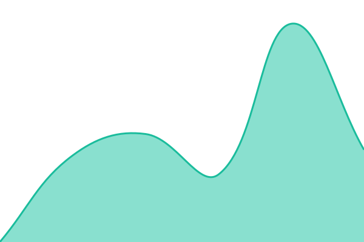
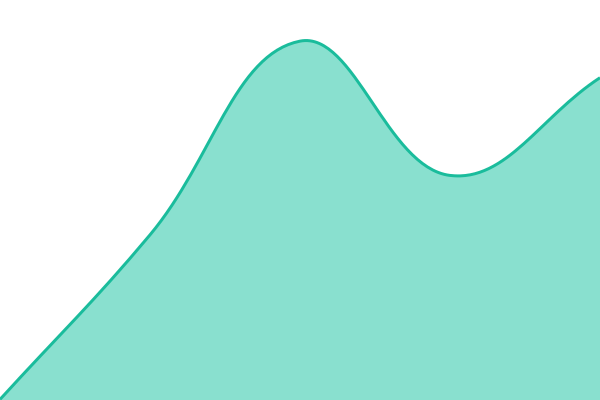
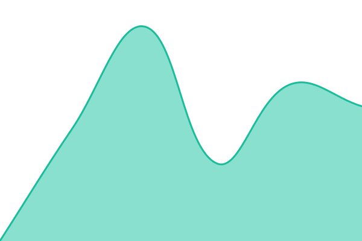

# [📈 Live Status](https://status.grovlix.com): <!--live status--> **🟩 All systems operational**

This repository contains the open-source uptime monitor and status page for [Grovlix](https://www.grovlix.com), powered by [Upptime](https://github.com/upptime/upptime).

With [Upptime](https://upptime.js.org), you can get your own unlimited and free uptime monitor and status page, powered entirely by a GitHub repository. We use [Issues](https://github.com/Grovlix/status/issues) as incident reports, [Actions](https://github.com/Grovlix/status/actions) as uptime monitors, and [Pages](https://status.grovlix.com) for the status page.

<!--start: status pages-->
<!-- This summary is generated by Upptime (https://github.com/upptime/upptime) -->
<!-- Do not edit this manually, your changes will be overwritten -->
<!-- prettier-ignore -->
| URL | Status | History | Response Time | Uptime |
| --- | ------ | ------- | ------------- | ------ |
|  [PopupSnap](https://popupsnap.com/health/release) | 🟩 Up | [popup-snap.yml](https://github.com/Grovlix/status/commits/HEAD/history/popup-snap.yml) | 

 667ms
     
 | 

<a href="https://status.grovlix.com/history/popup-snap">100.00%</a>
    

|  [InstaFeed](https://instafeed.popupsnap.com/api/health/ready) | 🟩 Up | [insta-feed.yml](https://github.com/Grovlix/status/commits/HEAD/history/insta-feed.yml) | 

 644ms
     
 | 

<a href="https://status.grovlix.com/history/insta-feed">100.00%</a>
    

|  [Product Studio](https://customizer.popupsnap.com/api/health) | 🟩 Up | [product-studio.yml](https://github.com/Grovlix/status/commits/HEAD/history/product-studio.yml) | 

 459ms
     
 | 

<a href="https://status.grovlix.com/history/product-studio">100.00%</a>
    

|  [PopAutomate](https://popautomate.com) | 🟩 Up | [pop-automate.yml](https://github.com/Grovlix/status/commits/HEAD/history/pop-automate.yml) | 

 1086ms
     
 | 

<a href="https://status.grovlix.com/history/pop-automate">100.00%</a>
    

|  [Lucky Wheel](https://popupsnap.com/product/lucky-wheel) | 🟩 Up | [lucky-wheel.yml](https://github.com/Grovlix/status/commits/HEAD/history/lucky-wheel.yml) | 

 830ms
     
 | 

<a href="https://status.grovlix.com/history/lucky-wheel">100.00%</a>
    

|  [Countdown Timer](https://popupsnap.com/product/countdown) | 🟩 Up | [countdown-timer.yml](https://github.com/Grovlix/status/commits/HEAD/history/countdown-timer.yml) | 

 908ms
     
 | 

<a href="https://status.grovlix.com/history/countdown-timer">100.00%</a>
    

<!--end: status pages-->

[**Visit our status website →**](https://status.grovlix.com)

## 📄 License

- Powered by: [Upptime](https://github.com/upptime/upptime)
- Code: [MIT](./LICENSE) © [Anand Chowdhary](https://anandchowdhary.com)
- Data in the `./history` directory: [Open Database License](https://opendatacommons.org/licenses/odbl/1-0/)
